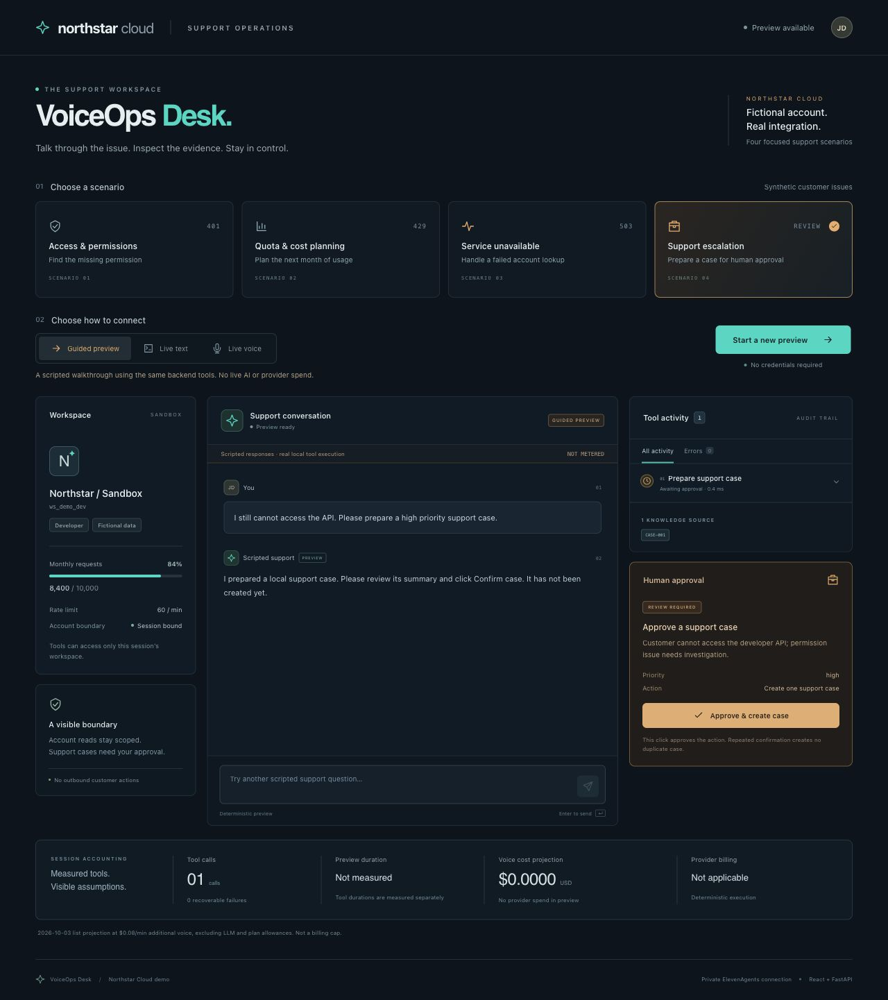
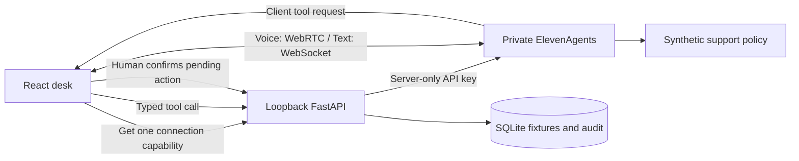

# VoiceOps Desk

A developer voice support desk that makes an agent's work inspectable: verified account facts, typed tools, explicit failures, human-approved actions and visible cost assumptions.

Built as a hands-on ElevenAgents integration and Solution Engineer demo. The customer is **Northstar Cloud**, a fictional developer platform. This project is independent of ElevenLabs and is not an official interview exercise.



## What to demonstrate

| Scenario | Customer problem | Observable behavior |
|---|---|---|
| Diagnose a 401 | “Should I replace my key?” | Distinguish `missing_permissions` from `invalid_api_key`; inspect the tool trace. |
| Plan a launch | “We expect 18,000 requests.” | Read fictional usage; compute a $53 Northstar plan forecast. |
| Tool outage | “Check my current usage.” | Show an explicit failure; avoid inventing a balance. |
| Escalation | “Prepare a support case.” | Prepare only; a human confirms; repeated confirmation returns one case. |

**Guided preview** is deterministic and free of provider calls. It runs the real local tools, but does not measure AI or voice performance. **Live text** and **Voice** connect to a private ElevenAgents agent through the official browser SDK; they require a configured key and cloud provisioning.

## Run locally

Requirements: Python 3.11+, [uv](https://docs.astral.sh/uv/), Node.js 22+ and npm.

```bash
uv sync --extra dev
npm --prefix frontend ci
npm --prefix frontend run build
uv run voiceops serve
```

Open http://127.0.0.1:7861 and choose Guided preview. All customer records and cases remain local. The server listens on loopback.

For live mode, inject `ELEVENLABS_API_KEY` into the server process. On macOS an existing generic-password Keychain item can be loaded with `--keychain`; the default service is `elevenlabs_api_key`. Do not put a real key in a tracked file or browser JavaScript. `.env.example` contains placeholders; the app does not automatically read `.env` files.

```bash
uv run voiceops doctor --keychain
uv run voiceops provision --keychain
uv run voiceops serve --keychain
```

The key needs ElevenAgents and Knowledge Base read/write access. `missing_permissions` is an endpoint access issue. The read-only doctor checks Agents access; successful cloud provisioning also verifies write and knowledge access. Provisioning creates only this demo's private agent, synthetic policy document and four client tools. Their IDs stay in ignored `data/cloud.json`; repeat setup reads the existing demo instead of modifying other agents.

Live voice begins only after a deliberate click and microphone permission. Audio/transcripts go to ElevenLabs; do not use confidential content. Cloud configuration disables audio recording, sets seven-day conversation retention, limits sessions to 90 seconds and disables concurrency bursting. The browser also stops at 90 seconds. These are duration/admission controls, not an account dollar limit. No paid session reconnects automatically.

## Integration



Workspace identity comes from the server session. Model-provided account IDs cannot grant access. Case preparation is an agent tool; case confirmation is a separate human control and database transaction. See [architecture](docs/rfc.md), [demo script](docs/demo-guide.md), [cost model](docs/costs.md) and [validation](docs/validation.md).

## Verify

```bash
uv run ruff check src tests
uv run pytest -q
npm --prefix frontend run build
```

CI is offline. Live tests are opt-in and consume provider credits; see the validation document for exactly what has been tested. Northstar's $29 plan and $0.003 request overage are invented support fixtures and must not be confused with ElevenAgents prices.

## Privacy and deployment scope

This repository contains publishable synthetic examples only. It excludes real keys, account diagnostics, provider connection capabilities, runtime conversations and private interview material. Cases are local demo records; no email, phone call or support message is sent. API keys stay on the server; connection tokens/URLs are transient browser capabilities and are never persisted by this app.

This is a single-user localhost portfolio tool. Public deployment requires application authentication, tenant authorization, admission quotas, distributed idempotence, retention/deletion controls and secret management. Browser client tools are useful for local application integration; production service-to-service actions should be evaluated separately. See [tradeoffs](docs/tradeoffs.md).

MIT licensed.
